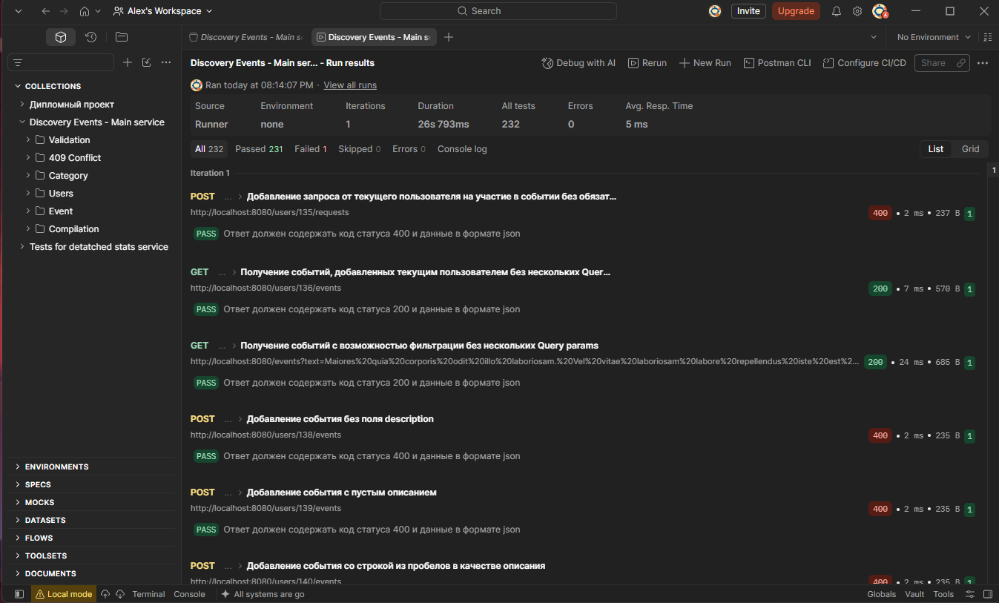
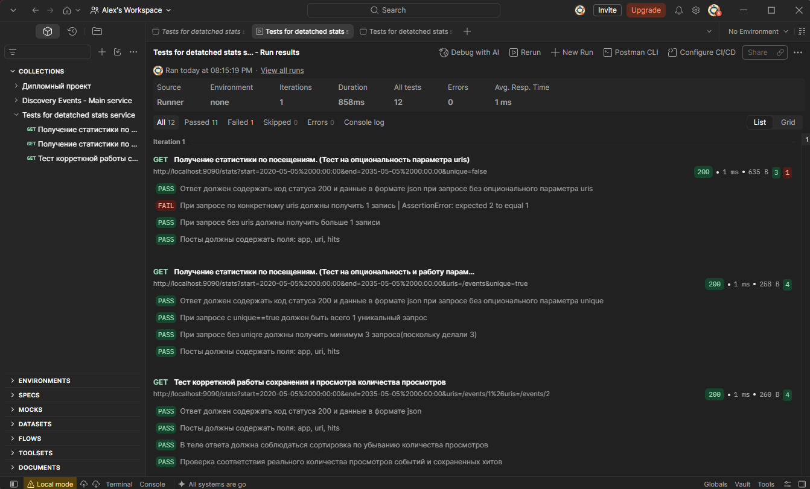

# Discovery Events

REST-сервис для создания и поиска событий. Пользователи могут подавать заявки на участие, организаторы — управлять событиями и заявками. Проект состоит из основного сервиса и отдельного сервиса статистики просмотров. Дополнительная функция — комментарии к событиям с модерацией.

## Структура проекта

```text
Discovery_diplom/
├── main-service/
│   └── src/
│       ├── main/java/org/example/discovery_diplom/
│       ├── main/resources/application.properties
│       └── test/java/org/example/discovery_diplom/
├── stats/
│   ├── stats-client/
│   │   └── src/main/java/.../StatsClient.java
│   ├── stats-dto/
│   └── stats-server/
└── pom.xml
```

### Основной сервис

Код приложения находится в `main-service/src/main/java/org/example/discovery_diplom/`.

- `DiscoveryDiplomApplication.java` — точка входа Spring Boot приложения.
- `controller/` — REST-контроллеры. Принимают HTTP-запросы и передают обработку сервисам. Контроллеры разделены на публичные, пользовательские и административные.
- `service/` — логика приложения: события, пользователи, категории, подборки, заявки и комментарии.
- `repository/` — интерфейсы Spring Data JPA для чтения и сохранения данных в PostgreSQL.
- `model/` — сущности базы данных и перечисления состояний.
- `dto/` — объекты, используемые для входящих запросов и ответов API.
- `exception/` — исключения для ситуаций, например, когда пользователь, категория или событие не найдены.
- `resources/application.properties` — настройки основного сервиса и подключения к базе данных.

### Комментарии

- `PublicCommentController.java` — получение опубликованных комментариев.
- `UserCommentController.java` — добавление и изменение комментария пользователем.
- `AdminCommentController.java` — просмотр и модерация комментариев администратором.
- `CommentService.java` — проверки и бизнес-логика комментариев.
- `CommentRepository.java` — запросы к таблице комментариев.
- `Comment.java`, `CommentStatus.java` — сущность комментария и его статус.
- `NewCommentRequest.java`, `UpdateCommentRequest.java`, `ModerateCommentRequest.java`, `CommentDto.java` — данные запросов и ответов для операций с комментариями.

### Сервис статистики

Модули статистики находятся в `stats/`.

- `stats-client/` — клиент, через который основной сервис отправляет данные о просмотрах серверу статистики.
- `stats-dto/` — объекты передачи данных между основным сервисом и сервером статистики.
- `stats-server/` — отдельное Spring Boot приложение, которое принимает и сохраняет просмотры и возвращает агрегированную статистику.
- Внутри `stats-server`: `controller/` принимает запросы, `service/` обрабатывает их, `repository/` работает с базой данных, `model/` описывает сущность просмотра.
- `stats-server/src/main/resources/application.properties` — настройки сервера статистики и его базы данных.

## Тесты

Unit-тесты находятся в `src/test/java` соответствующих модулей. Они проверяют отдельные части логики в изоляции, используя моки вместо реальной базы данных:

- `CommentServiceTest` — создание комментария со статусом модерации, возврат изменённого комментария на модерацию, выдачу только опубликованных комментариев и запрет недопустимого статуса при модерации.
- `EventServiceAdminUpdateTest` — сценарии административного изменения событий.
- `ParticipationRequestServiceTest` — сценарии работы с заявками на участие.
- `EndpointHitServiceTest` — перенос данных хита из DTO в сущность и вызов сохранения через репозиторий.
- `DiscoveryDiplomApplicationTests` — базовая проверка загрузки контекста основного приложения.

## Проверки Postman

На скриншотах представлены результаты проверок API-коллекций.

### Основной сервис

232 проверки: 231 пройдена, 1 завершилась с ошибкой. Проверка «Поиск событий с проверкой параметров» сравнивает число подтверждённых заявок до и после подтверждения. В pre-request скрипте Postman предварительный GET-запрос выполняется через `pm.sendRequest`, но его callback не ожидается. Скрипт продолжает работу и подтверждает заявку, поэтому GET может завершиться уже после подтверждения. Тогда переменная с числом заявок до подтверждения получает `1`, хотя тест ожидает `0`. Это гонка в подготовительном скрипте Postman.



### Сервер статистики

12 проверок: 11 пройдены, 1 завершилась с ошибкой. Проверка для URI `/events` ожидает одну строку статистики. Запрос статистики группирует просмотры по приложению и URI, поэтому для одного URI возвращается отдельная строка каждого приложения. В общей базе просмотры `/events` могут быть записаны как приложением `events-service` из тестовой коллекции, так и `Discovery_diplom` из основного сервиса. В этом случае API возвращает две корректные строки, а ожидание одной строки в тесте не учитывает совместное использование базы.


